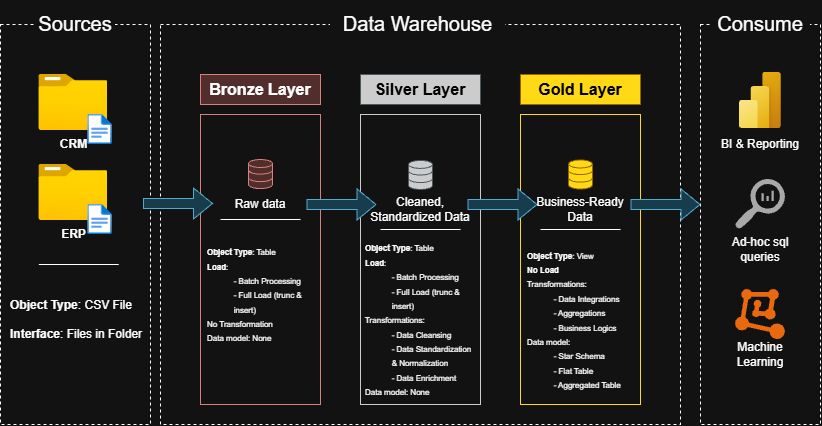
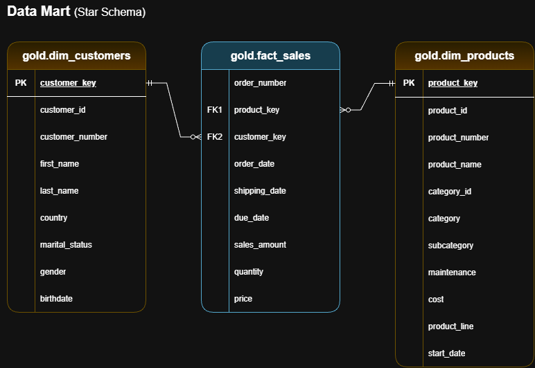

# SQL Data Warehouse Project

## Project Overview

This project demonstrates the development of a modern SQL-based Data Warehouse using **PostgreSQL** and the **Medallion Architecture**.

The goal is to integrate data from CRM and ERP source systems, transform raw data into clean and standardized datasets, and create a business-ready data model for analytics and reporting.

## Data Architecture

The project follows the Medallion Architecture, consisting of three layers: **Bronze**, **Silver** and **Gold**

- **Bronze:** Stores raw data imported from CRM and ERP CSV files without applying transformations.
- **Silver:** Cleans, standardizes, and transforms data to improve its quality and consistency.
- **Gold:** Integrates data into business-friendly dimension and fact views, following a Star Schema.

## Data Sources

The project uses two source systems provided as CSV files:

- **CRM:** Customer information, product information, and sales details.
- **ERP:** Customer details, location information, and product categories.

## Data Processing

Data is processed through SQL-based ETL workflows:

1. **Data Ingestion:** Load source CSV files into Bronze tables.
2. **Data Cleaning:** Identified and handled duplicate records, missing values, inconsistent formats, invalid values, and other data quality issues.
3. **Data Transformation:** Clean and standardize data in the Silver layer.
4. **Data Modeling:** Integrated data into dimension and fact views in the Gold layer.
5. **Data Validation:** Performed data quality checks across the layers to identify inconsistencies and missing relationships.

The Bronze and Silver layers use a full-refresh approach (`TRUNCATE` and `INSERT`), while the Gold layer consists of SQL views.

## Gold Data Model

The Gold layer follows a **Star Schema** and contains three analytical views:

- `gold.dim_customers` – Customer attributes and demographic information.
- `gold.dim_products` – Product details and category information.
- `gold.fact_sales` – Sales transactions, dates, quantities, and sales amounts.

Surrogate keys for the customer and product dimensions are generated using `ROW_NUMBER()` and used to connect the fact view to the dimensions.

For detailed column descriptions and relationships, see [Gold Data Catalog](docs/gold_data_catalog.md).

## Technologies & Tools

- **PostgreSQL** – Database management and SQL transformations.
- **SQL** – Data definition, ingestion, transformation, and validation.
- **pgAdmin** – Database management and query execution.
- **Visual Studio Code** – SQL development.
- **Draw.io** – Data architecture and data model diagrams.
- **Git & GitHub** – Version control and project documentation.

## What I Learned

Through this project, I gained practical experience with:

- Designing a Data Warehouse using Medallion Architecture.
- Working with PostgreSQL and writing advanced SQL queries.
- Building SQL-based ETL workflows using stored procedures.
- Identifying and resolving data quality issues.
- Applying data cleansing and transformation techniques.
- Understanding dimensional data modeling and Star Schema.
- Working with fact and dimension views and surrogate keys.
- Performing data quality checks and documenting a Data Warehouse.

## Conclusions

This project gave me practical experience in building a Data Warehouse from raw source data to a business-ready analytical model.

It helped me understand the importance of data quality, structured data pipelines, and dimensional modeling in data engineering.

The final result is a PostgreSQL Data Warehouse that integrates CRM and ERP data into a structured model suitable for further analysis and reporting.

**Next step:** Perform Exploratory Data Analysis (EDA) using the data prepared in this project.

## Project Documentation

Additional documentation is available in the [`docs/`](docs/) directory.